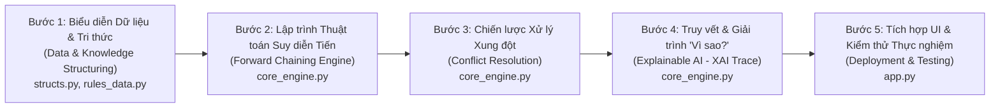
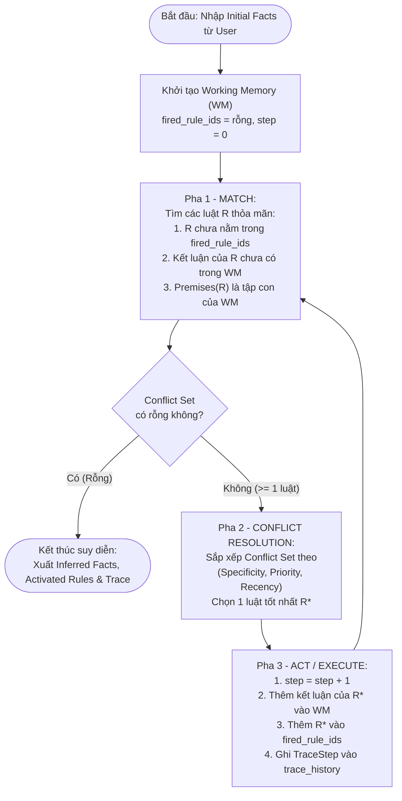

### 1. Hai nhánh thuật toán cơ bản

| Nhánh AI | Bản chất cốt lõi | Các thuật toán cơ bản  |  |
| :--- | :--- | :--- | :--- |
| **1. AI Biểu tượng & Hệ chuyên gia (Symbolic AI / Knowledge-Based Systems)** | Dựa trên **Luật suy diễn (`IF-THEN`)** và **Logic mệnh đề / vị từ**. Minh bạch 100%, giải thích được từng bước ("Vì sao?"). | • **Suy diễn tiến (Forward Chaining)**: Đi từ Sự kiện $\rightarrow$ Kết luận.<br>• **Suy diễn lùi (Backward Chaining)**: Đi từ Đích $\rightarrow$ Tìm sự kiện chứng minh.<br>• **Xử lý xung đột (Conflict Resolution)**: *Refractoriness, Specificity, Priority, Recency*.<br>• **Tìm kiếm đồ thị (BFS, DFS, A\*)**: Duyệt cây/đồ thị trạng thái `AND-OR`. | **Đây chính là trọng tâm đồ án của TV3 ở GĐ 2 & GĐ 3** (`structs.py`, `core_engine.py`). |
| **2. Máy học Thống kê (Statistical Machine Learning)** | Máy tự học quy luật (hàm mục tiêu $f(x) = y$) từ dữ liệu lịch sử thay vì con người viết luật thủ công. | • **Cây quyết định (Decision Tree - ID3, C4.5, CART)**: Dùng *Entropy & Information Gain* để tách nhánh — mỗi đường đi từ gốc tới lá chính là 1 luật `IF-THEN`!<br>• **Naive Bayes**: Suy diễn xác suất hậu nghiệm $P(Y\|X)$ theo định lý Bayes.<br>• **k-NN, Linear/Logistic Regression, SVM, K-Means**. | Giúp TV3 hiểu: Khi chưa có dữ liệu lớn để train ML, ta dùng **Hệ chuyên gia suy diễn luật**; hoặc rút trích luật từ **Cây quyết định ID3** đưa vào `rules_data.py`. |

### 2. Ánh xạ 5 Bước Lập trình Chuẩn Máy học (ML Pipeline) sang 5 Bước Xây dựng Hệ Suy Diễn của TV3

Một quy trình kỹ thuật AI/ML chuẩn công nghiệp luôn đi qua **5 bước vàng**. Khi áp dụng vào đồ án Giai đoạn 2 & 3 của TV3, chúng tương ứng hoàn hảo như sau:



--
## PHẦN II: BỘ CÂU HỎI 5W1H (WHAT - WHY - WHERE - WHEN - WHO - HOW) CHO 5 BƯỚC THỰC HIỆN CỦA TV3

Dưới đây là hệ thống câu hỏi định hướng và lời giải chi tiết theo mô hình **5W1H** cho từng bước trong 5 bước thực thi nhiệm vụ của **TV3** từ **Ngày 1 đến Ngày 5**.

---

### 🔹 BƯỚC 1: Chuẩn hóa Tri thức Excel & Định nghĩa Cấu trúc `Fact` / `Rule` (Giai đoạn 2 – Ngày 1)

#### ❓ Bộ câu hỏi 5W1H Bước 1:
1. **WHAT (Làm cái gì?):**
   - *Câu hỏi:* TV3 cần chuyển đổi bảng Excel của nhóm thành những cấu trúc dữ liệu (Class) nào trong Python? Mỗi Class cần những thuộc tính gì để không bị thiếu thông tin khi suy diễn ở Ngày 2 và giải trình ở Ngày 3?
   - *Trả lời:* Cần định nghĩa 3 `@dataclass` chuẩn trong `structs.py`:
     - `Fact`: gồm `id` (mã sự kiện, VD `'F01'`), `description` (mô tả tiếng Việt), `source` (`'user'` hoặc `'inferred'`), `by_rule` (mã luật sinh ra sự kiện này), và `timestamp_step` (bước thời gian sự kiện xuất hiện để phục vụ tiêu chí *Recency*).
     - `Rule`: gồm `id` (mã luật, VD `'R01'`), `premises` (danh sách mã Fact ở vế `IF`), `conclusion` (mã Fact ở vế `THEN`), `priority` (độ ưu tiên), `explanation` (lời giải thích chuyên gia).
     - `TraceStep`: lưu nhật ký từng bước kích hoạt luật (`step_number`, `conflict_set`, `fired_rule`, `new_fact`, `resolution_reason`).
2. **WHY (Tại sao phải làm như vậy?):**
   - *Câu hỏi:* Tại sao không lưu luật bằng chuỗi văn bản thuần (ví dụ `"Nếu sốt và ho thì cảm cúm"`) mà phải mã hóa thành `id` (`F01`, `F02`, `R01`) và tách thành Class `Fact` / `Rule`?
   - *Trả lời:*
     - Nếu so khớp bằng chuỗi tiếng Việt sẽ dễ dính lỗi chính tả, dấu cách, chữ hoa/thường làm thuật toán không khớp được luật.
     - Nếu `Fact` không lưu thuộc tính `by_rule` và `timestamp_step`, đến Ngày 3 và Ngày 4 sẽ **không thể làm được tính năng Giải trình "Vì sao?"** và tiêu chí **Recency (Sự kiện mới nhất)**.
3. **WHERE (Làm ở đâu?):**
   - *Câu hỏi:* Code của Bước 1 đặt ở những file nào trong thư mục dự án?
   - *Trả lời:*
     - Cấu trúc lớp đặt tại file `structs.py`.
     - Dữ liệu sự kiện (`FACT_CATALOG`), danh sách luật (`RULES_DATA`) và hàm đọc CSV/Excel (`load_rules_from_csv`) đặt tại file `rules_data.py`.
4. **WHEN (Khi nào thực hiện?):**
   - *Câu hỏi:* Bước này thực hiện vào ngày nào trong lịch trình và khi nào nó được gọi lúc chạy chương trình?
   - *Trả lời:* Thực hiện vào **Ngày 1 (Thứ 2) thuộc Giai đoạn 2**. Lúc chương trình chạy (runtime), các đối tượng `Rule` được nạp ngay khi khởi tạo `ForwardChainingEngine.__init__()`.
5. **WHO (Ai thực hiện & phối hợp với ai?):**
   - *Câu hỏi:* TV3 phối hợp với ai ở Bước 1?
   - *Trả lời:* **TV1, TV2** rà soát bảng Excel tránh trùng lặp mã sự kiện; **TV3 và TV4** thống nhất thiết kế Class `Fact`/`Rule` trong `structs.py` và chuyển bảng luật vào `rules_data.py`.
6. **HOW (Làm như thế nào - Thuật toán kiểm tra luật khớp?):**
   - *Câu hỏi:* Làm thế nào để kiểm tra nhanh một luật $R$ có thỏa mãn tập sự kiện đang có trong Bộ nhớ làm việc (Working Memory - $WM$) hay không?
   - *Trả lời:* Sử dụng phép toán tập hợp (`set.issubset`) trong Python với độ phức tạp $O(|Premises(R)|)$:
     $$\text{is\_triggered}(R, WM) \iff \text{Premises}(R) \subseteq WM$$
     Trong code `structs.py`: `set(self.premises).issubset(known_fact_ids)`.

---

### 🔹 BƯỚC 2: Lập trình Động cơ Suy diễn Tiến – Forward Chaining (Giai đoạn 2 – Ngày 2)

#### ❓ Bộ câu hỏi 5W1H Bước 2:
1. **WHAT (Làm cái gì?):**
   - *Câu hỏi:* Động cơ Suy diễn tiến (`ForwardChainingEngine`) nhận đầu vào là gì, xử lý qua những pha nào và trả về đầu ra là gì?
   - *Trả lời:*
     - **Đầu vào (Input):** Danh sách các mã sự kiện ban đầu người dùng chọn (`initial_fact_ids`, ví dụ `['F01', 'F02', 'F03']`).
     - **Quá trình xử lý:** Lặp liên tục chu trình 3 pha **Match (Đối sánh) $\rightarrow$ Resolve (Xử lý xung đột) $\rightarrow$ Act (Kích hoạt luật & thêm Fact mới vào Working Memory)**.
     - **Đầu ra (Output):** Tập sự kiện mới suy diễn được (`inferred_facts`), danh sách các luật đã kích hoạt theo thứ tự (`activated_rules`), và lịch sử vết suy diễn (`trace_history`).
2. **WHY (Tại sao chọn Suy diễn tiến & Tại sao cần điều kiện dừng?):**
   - *Câu hỏi:* Tại sao bài toán này dùng Suy diễn tiến (Forward Chaining) và điều gì ngăn cản vòng lặp `while True` bị lặp vô hạn (Infinite Loop)?
   - *Trả lời:*
     - Dùng **Suy diễn tiến** vì người dùng cung cấp các triệu chứng/sở thích ban đầu (Data-driven) và muốn biết mọi kết luận có thể suy ra từ đó.
     - Vòng lặp `while True` **đảm bảo dừng 100%** sau tối đa $|Rules|$ bước nhờ 2 chốt chặn trong hàm `_match_conflict_set()`:
       1. `rule.id not in self.fired_rule_ids` (**Nguyên lý Refractoriness**: Mỗi luật chỉ kích hoạt tối đa 1 lần).
       2. `rule.conclusion not in known_ids` (Không kích hoạt luật nếu kết luận của nó đã tồn tại trong Working Memory).
3. **WHERE (Làm ở đâu?):**
   - *Câu hỏi:* Thuật toán Suy diễn tiến nằm ở class nào, phương thức nào?
   - *Trả lời:* Nằm trong file `core_engine.py`, tại class `ForwardChainingEngine`, cụ thể ở các phương thức `load_initial_facts()`, `_match_conflict_set()` và `forward_chain()`.
4. **WHEN (Khi nào thực hiện?):**
   - *Câu hỏi:* Khi nào bắt đầu code Bước 2 và khi nào vòng lặp suy diễn kết thúc?
   - *Trả lời:* Thực hiện vào **Ngày 2 (Thứ 3) – Giai đoạn 2**. Vòng lặp suy diễn kết thúc ngay khi `conflict_set` rỗng (không còn luật nào thỏa mãn) hoặc khi tìm thấy `target_fact_id` (nếu có truyền đích cụ thể).
5. **WHO (Ai thực hiện?):**
   - *Câu hỏi:* Ai chịu trách nhiệm chính ở bước này?
   - *Trả lời:* **TV3 và TV4** cùng lập trình `core_engine.py`. TV3 viết khung vòng lặp suy diễn chính và cấu trúc lưu vết, TV4 phối hợp kiểm tra logic tập xung đột.
6. **HOW (Làm như thế nào - Sơ đồ thuật toán?):**
   - *Câu hỏi:* Luồng chạy chi tiết của thuật toán Suy diễn tiến diễn ra như thế nào?
   - *Trả lời:* Xem sơ đồ thuật toán dưới đây:



---

### 🔹 BƯỚC 3: Thiết kế Bộ Xử lý Xung đột Đa tiêu chí – Conflict Resolution (Giai đoạn 2 – Ngày 2)

#### ❓ Bộ câu hỏi 5W1H Bước 3:
1. **WHAT (Làm cái gì?):**
   - *Câu hỏi:* "Xung đột luật" (Rule Conflict) là gì và Bộ xử lý xung đột cần làm gì?
   - *Trả lời:* Xung đột xảy ra khi trong cùng 1 vòng lặp suy diễn, có **từ 2 luật trở lên cùng thỏa mãn điều kiện vế `IF`** (ví dụ ở Bước 1: cả `R01` và `R08` cùng thỏa mãn; ở Bước 3: cả `R03` và `R04` cùng thỏa mãn). Bộ xử lý xung đột phải xếp hạng các luật này và **chọn ra đúng 1 luật tối ưu nhất** để kích hoạt trước.
2. **WHY (Tại sao phải xử lý xung đột?):**
   - *Câu hỏi:* Tại sao không kích hoạt đại luật đầu tiên hoặc kích hoạt tất cả cùng lúc?
   - *Trả lời:*
     - Trong Hệ chuyên gia thực tế, các luật có độ tin cậy và mức độ chi tiết khác nhau. Luật xét 3 triệu chứng (`IF A AND B AND C THEN D`) phải chính xác và được ưu tiên hơn luật chỉ xét 1 triệu chứng (`IF A THEN E`).
     - Thứ tự kích hoạt luật quyết định thứ tự sinh ra các sự kiện mới trong Working Memory (`timestamp_step`) và làm thay đổi đường đi của cây suy diễn.
3. **WHERE (Làm ở đâu?):**
   - *Câu hỏi:* Hàm xử lý xung đột được cài đặt ở đâu?
   - *Trả lời:* Tại phương thức `_resolve_conflict(self, conflict_set)` và `_get_rule_recency(self, rule)` trong file `core_engine.py`.
4. **WHEN (Khi nào kích hoạt?):**
   - *Câu hỏi:* Khi nào thuật toán xử lý xung đột thực sự phải phân xử?
   - *Trả lời:* Thực hiện code vào **Ngày 2 (Thứ 3)**. Trong lúc chạy, hàm được gọi ở mỗi vòng lặp ngay sau pha `MATCH` khi `len(conflict_set) >= 1` (đặc biệt phân xử khi `len(conflict_set) > 1`).
5. **WHO (Ai thực hiện?):**
   - *Câu hỏi:* Ai phụ trách phần này?
   - *Trả lời:* **TV3 và TV4** cùng cài đặt và thử nghiệm các chiến lược (`combined`, `specificity`, `priority`, `recency`, `first_match`).
6. **HOW (Làm như thế nào - Công thức toán học & Python?):**
   - *Câu hỏi:* Làm thế nào để kết hợp cả 4 tiêu chí xử lý xung đột kinh điển của AI chỉ bằng vài dòng code Python thanh lịch?
   - *Trả lời:* Ta biểu diễn điểm số của mỗi luật $R \in \text{ConflictSet}$ bằng một vector 3 chiều (Tuple trong Python) và sắp xếp giảm dần (`reverse=True`):
     $$\text{Score}(R) = \Big( \underbrace{|\text{Premises}(R)|}_{\text{1. Specificity}}, \quad \underbrace{\text{Priority}(R)}_{\text{2. Salience}}, \quad \underbrace{\max_{f \in \text{Premises}(R)} \text{step}(f)}_{\text{3. Recency}} \Big)$$
     Trong Python (`core_engine.py`):
     ```python
     sorted_rules = sorted(
         conflict_set,
         key=lambda r: (r.specificity, r.priority, self._get_rule_recency(r)),
         reverse=True
     )
     chosen_rule = sorted_rules[0]
     ```
     *Lưu ý:* Vì hàm `sorted()` của Python có tính ổn định (**Timsort - Stable Sort**), nếu 2 luật bằng nhau ở cả 3 tiêu chí trên, Python tự động giữ nguyên thứ tự xuất hiện ban đầu trong danh sách (tức là thỏa mãn luôn tiêu chí thứ 4: **Rule Order / First-Match**)!

---

### 🔹 BƯỚC 4: Tích hợp Lõi AI & Khởi tạo Module Giải trình Vết suy diễn "Vì sao?" (Giai đoạn 2 & 3 – Ngày 3)

#### ❓ Bộ câu hỏi 5W1H Bước 4:
1. **WHAT (Làm cái gì?):**
   - *Câu hỏi:* Module Giải trình vết suy diễn (Explanation Facility) ở Ngày 3 & Ngày 4 cần trả lời được những câu hỏi nào của người dùng?
   - *Trả lời:* Cần giải quyết 2 yêu cầu cốt lõi của Giai đoạn 3:
     1. **Xuất danh sách luật kích hoạt & Nhật ký từng bước (`format_trace_report`)**: Cho biết ở Bước 1, Bước 2, Bước 3... tập xung đột gồm những luật nào, luật nào thắng, vì sao thắng, và sinh ra sự kiện gì.
     2. **Trả lời câu hỏi "Vì sao hệ thống đưa ra kết luận X?" (`explain_why_fact`)**: Vẽ ra cây giải thích đệ quy từ kết luận cuối cùng ngược về các luật trung gian cho tới các sự kiện gốc ban đầu do người dùng tích chọn.
2. **WHY (Tại sao Hệ chuyên gia bắt buộc phải có Module Giải trình?):**
   - *Câu hỏi:* Tại sao chỉ in ra kết luận cuối cùng là chưa đủ mà phải có Module Giải trình "Vì sao?"?
   - *Trả lời:* Điểm mạnh lớn nhất của Hệ chuyên gia so với Deep Learning (hộp đen - Black Box) là **Khả năng giải thích (Explainability / Glass Box)**. Trong y tế, tài chính hay tư vấn học tập, người dùng chỉ tin tưởng kết luận của AI khi hệ thống chỉ rõ chuỗi lập luận logic dẫn tới kết luận đó.
3. **WHERE (Làm ở đâu?):**
   - *Câu hỏi:* Code giải trình nằm ở đâu để vừa dùng được trên CLI vừa dùng được trên Streamlit UI?
   - *Trả lời:* Đặt trực tiếp trong `core_engine.py` thông qua 2 hàm `explain_why_fact(fact_id)` và `format_trace_report()` để **TV5** chỉ cần gọi 1 hàm là hiển thị được ngay trên `app.py`.
4. **WHEN (Khi nào thực hiện?):**
   - *Câu hỏi:* Bước này làm vào ngày nào trong kế hoạch?
   - *Trả lời:* Khởi tạo vào **Ngày 3 (Thứ 4) – Giao thoa GĐ 2 & GĐ 3** và hoàn thiện hiển thị vào **Ngày 4 (Thứ 5) – GĐ 3**.
5. **WHO (Ai thực hiện?):**
   - *Câu hỏi:* TV3 phối hợp với TV4 và TV5 như thế nào ở Ngày 3 và Ngày 4?
   - *Trả lời:*
     - **Ngày 3:** **TV3, TV4** đóng gói hàm chạy suy diễn, trả về `activated_rules` và `trace_history` bàn giao cho **TV5**.
     - **Ngày 4:** **TV5** thiết kế giao diện `app.py`, **TV3 hỗ trợ TV5** gắn hàm `explain_why_fact()` vào mục *"Vì sao?"* trên giao diện.
6. **HOW (Làm như thế nào - Thuật toán đệ quy truy vết cây suy diễn?):**
   - *Câu hỏi:* Thuật toán `explain_why_fact(fact_id)` hoạt động ra sao?
   - *Trả lời:* Sử dụng **Duyệt cây đệ quy theo chiều sâu (DFS Backward Proof Tree)** trên các sự kiện đã có trong `working_memory`:
     - **Điều kiện cơ sở (Base case):** Nếu `fact.source == "user"` $\rightarrow$ In ra: *"Sự kiện gốc do người dùng cung cấp ban đầu"* và dừng nhánh đệ quy.
     - **Bước đệ quy (Recursive step):** Nếu `fact.source == "inferred"` $\rightarrow$ Tra luật `R = fact.by_rule`, in ra lời giải thích `R.explanation`, sau đó gọi đệ quy `explain_why_fact(p, indent + 2)` cho từng điều kiện tiền đề `p` trong `R.premises`.

---

### 🔹 BƯỚC 5: Tích hợp Giao diện `app.py` & Kiểm thử Thực nghiệm 5–10 Test Cases (Giai đoạn 3 & 4 – Ngày 4, 5, 7)

#### ❓ Bộ câu hỏi 5W1H Bước 5:
1. **WHAT (Làm cái gì?):**
   - *Câu hỏi:* Ở bước cuối này, sản phẩm hoàn chỉnh cần chạy được như thế nào và kiểm thử những gì?
   - *Trả lời:*
     - Hoàn thiện file `app.py` chạy được cả trên **CLI (`python app.py`)** lẫn **Web UI (`streamlit run app.py`)**.
     - Kiểm thử từ **5–10 kịch bản (Test Cases)** bao phủ các trường hợp: suy diễn 1 bước, suy diễn bắc cầu nhiều bước (2–4 bước), có xung đột luật phức tạp, và trường hợp không có luật nào thỏa mãn.
2. **WHY (Tại sao cần hỗ trợ cả CLI và Streamlit trong `app.py`?):**
   - *Câu hỏi:* Tại sao nên thiết kế `app.py` chạy được cả khi gõ `python app.py` lẫn `streamlit run app.py`?
   - *Trả lời:* Giúp **TV3, TV4, TV6** có thể chạy tự động 5–10 Test Cases ngay trên Terminal trong 1 giây để bắt lỗi logic mà không cần bấm tay từng nút trên giao diện web; đồng thời vẫn có giao diện Streamlit đẹp mắt để **TV5** và cả nhóm Demo vào Chủ nhật (Ngày 7).
3. **WHERE (Làm ở đâu?):**
   - *Câu hỏi:* File nào chứa code giao diện và kịch bản kiểm thử?
   - *Trả lời:* File `app.py` trong thư mục gốc `d:\TRÍ TUỆ NHÂN TẠO`.
4. **WHEN (Khi nào thực hiện?):**
   - *Câu hỏi:* Thực hiện vào những ngày nào?
   - *Trả lời:* **Ngày 4 (Thứ 5)** làm UI với TV5; **Ngày 5 (Thứ 6)** chạy Test Cases cùng TV6; **Ngày 7 (Chủ nhật)** họp nhóm tổng duyệt Demo.
5. **WHO (Ai thực hiện?):**
   - *Câu hỏi:* Ai tham gia cùng TV3?
   - *Trả lời:* **TV5** chủ trì UI (TV3 hỗ trợ kỹ thuật), **TV6** chủ trì kịch bản Test (TV3 fix lỗi logic suy diễn nếu phát sinh).
6. **HOW (Làm như thế nào để chạy chương trình?):**
   - *Câu hỏi:* TV3 dùng lệnh gì để chạy kiểm thử và chạy giao diện?
   - *Trả lời:*
     - Chạy kiểm thử lõi suy diễn (Ngày 2 & 3):
       ```powershell
       python -X utf8 core_engine.py
       ```
     - Chạy 5 kịch bản Test Cases trên CLI (Ngày 4 & 5):
       ```powershell
       python -X utf8 app.py
       ```
     - Chạy giao diện Web Streamlit (Ngày 4 & 7):
       ```powershell
       streamlit run app.py
       ```

---

## PHẦN III: BỘ CÂU HỎI PHẢN BIỆN KHI BẢO VỆ ĐỒ ÁN (GIẢNG VIÊN HỎI – TV3 TRẢ LỜI)

Khi giảng viên chấm đồ án, vì **TV3** phụ trách phần **Suy diễn tiến & Xử lý xung đột**, thầy/cô chắc chắn sẽ xoáy sâu vào phần của bạn. Hãy nắm vững 5 câu hỏi – đáp "ăn điểm A+" dưới đây:

### Câu 1: *"Em hãy chỉ cho thầy/cô trong code của em, chỗ nào đảm bảo thuật toán Suy diễn tiến không bị rơi vào vòng lặp vô hạn khi tập luật có chu trình (ví dụ R1: A $\rightarrow$ B, R2: B $\rightarrow$ A)?"*
- **TV3 trả lời:** Thưa thầy/cô, trong hàm `_match_conflict_set()` ở file `core_engine.py`, em cài đặt **2 chốt chặn an toàn**:
  1. **Nguyên lý Refractoriness (`rule.id in self.fired_rule_ids`)**: Mỗi luật sau khi kích hoạt sẽ được đưa vào tập hợp `self.fired_rule_ids` và không bao giờ được xét lại lần thứ hai.
  2. **Kiểm tra sự kiện dư thừa (`rule.conclusion in known_ids`)**: Nếu kết luận của luật đã nằm trong Bộ nhớ làm việc (`working_memory`) rồi thì luật đó cũng bị bỏ qua. Với ví dụ $R_1: A \rightarrow B$ và $R_2: B \rightarrow A$, khi $A$ đã có sẵn trong Working Memory từ đầu, luật $R_2$ (kết luận $A$) sẽ bị loại ngay lập tức vì $A$ đã tồn tại trong `known_ids`. Do tập luật là hữu hạn ($N$ luật), vòng lặp `while` chạy tối đa không quá $N$ bước.

### Câu 2: *"Khi có 2 luật cùng thỏa mãn một lúc, hệ thống của em chọn luật nào trước? Vì sao?"*
- **TV3 trả lời:** Thưa thầy/cô, ở hàm `_resolve_conflict()` trong `core_engine.py`, em cài đặt chiến lược kết hợp đa tiêu chí (`combined`) theo thứ tự ưu tiên chuẩn của Hệ chuyên gia:
  1. **Specificity (Độ đặc thù - `len(rule.premises)`)**: Luật nào có nhiều điều kiện `IF` hơn sẽ được ưu tiên trước vì nó xét hoàn cảnh cụ thể hơn.
  2. **Priority (Độ ưu tiên chuyên gia - `rule.priority`)**: Nếu số điều kiện bằng nhau, luật nào được chuyên gia gán trọng số ưu tiên cao hơn sẽ chạy trước.
  3. **Recency (Tính mới của sự kiện - `_get_rule_recency`)**: Nếu vẫn bằng nhau, hệ thống ưu tiên luật sử dụng sự kiện vừa mới được suy diễn ở bước gần nhất (`timestamp_step` lớn nhất) để giữ mạch suy luận liên tục.
  4. **Rule Order**: Nếu cả 3 chỉ số trên đều bằng nhau, thuật toán giữ nguyên thứ tự luật từ trên xuống.

### Câu 3: *"Làm sao hệ thống của em trả lời được câu hỏi 'Vì sao?' ở Giai đoạn 3?"*
- **TV3 trả lời:** Thưa thầy/cô, mỗi khi một sự kiện mới được sinh ra trong hàm `forward_chain()`, em không chỉ lưu mã sự kiện mà lưu cả đối tượng `Fact` có thuộc tính `by_rule` (luật nào sinh ra nó) và `timestamp_step` (sinh ra ở bước mấy), đồng thời lưu đối tượng `TraceStep` vào `trace_history`. Khi người dùng bấm hỏi *"Vì sao kết luận được sự kiện X?"*, hàm `explain_why_fact(X)` sẽ duyệt cây đệ quy ngược từ kết luận $X \rightarrow$ tìm luật $R$ sinh ra $X \rightarrow$ lấy các sự kiện ở vế `IF` của $R$ và tiếp tục truy ngược cho đến khi chạm tới các sự kiện gốc (`source == "user"`) do người dùng nhập.

### Câu 4: *"Sự khác biệt giữa Suy diễn tiến (Forward Chaining) mà nhóm em làm và Suy diễn lùi (Backward Chaining) là gì?"*
- **TV3 trả lời:**
  - **Suy diễn tiến (Data-driven)** đi từ **Sự kiện ban đầu $\rightarrow$ Kết luận**, phù hợp khi người dùng nhập vào một loạt triệu chứng/dữ liệu và muốn biết hệ thống suy ra được những kết luận nào.
  - **Suy diễn lùi (Goal-driven)** đi từ **Một giả thuyết/kết luận đích $\rightarrow$ Lần ngược lại các điều kiện tiền đề** để hỏi người dùng xem giả thuyết đó đúng hay sai. Trong đồ án này, nhóm em dùng **Suy diễn tiến** để tìm ra kết luận, nhưng ở **Module Giải trình "Vì sao?" (`explain_why_fact`)**, nhóm em lại dùng chính kỹ thuật **truy ngược từ Kết luận về Sự kiện gốc** (tương tự cấu trúc cây chứng minh của Suy diễn lùi) để giải thích cho người dùng.

### Câu 5: *"Nếu bây giờ TV1 và TV2 sửa nội dung luật trong file Excel thì em (TV3) có phải sửa lại code trong `core_engine.py` không?"*
- **TV3 trả lời:** Hoàn toàn **không phải sửa bất kỳ dòng code nào trong `core_engine.py`** ạ! Vì nhóm em đã thiết kế tuân thủ nguyên tắc tách biệt **Cơ sở tri thức (Knowledge Base - `rules_data.py`)** khỏi **Động cơ suy diễn (Inference Engine - `core_engine.py`)**. Khi TV1 và TV2 cập nhật luật mới trong `rules_data.py` hoặc file CSV, `ForwardChainingEngine` vẫn chạy tự động 100%.

---

## PHẦN IV: DANH MỤC FILE BÀN GIAO ĐÃ KHỞI TẠO SẴN CHO TV3 TRONG WORKSPACE

Toàn bộ các file sản phẩm đầu ra của **TV3** theo đúng bảng phân công đã được lập trình hoàn chỉnh và kiểm thử tại thư mục `d:\TRÍ TUỆ NHÂN TẠO`:

1. [`structs.py`](file:///d:/TRÍ%20TUỆ%20NHÂN%20TẠO/structs.py): Định nghĩa các class [`Fact`](file:///d:/TRÍ%20TUỆ%20NHÂN%20TẠO/structs.py#L12-L31), [`Rule`](file:///d:/TRÍ%20TUỆ%20NHÂN%20TẠO/structs.py#L35-L62), [`TraceStep`](file:///d:/TRÍ%20TUỆ%20NHÂN%20TẠO/structs.py#L66-L76) *(Sản phẩm Ngày 1 - GĐ 2)*.
2. [`rules_data.py`](file:///d:/TRÍ%20TUỆ%20NHÂN%20TẠO/rules_data.py): Cơ sở tri thức [`FACT_CATALOG`](file:///d:/TRÍ%20TUỆ%20NHÂN%20TẠO/rules_data.py#L19-L40), [`RULES_DATA`](file:///d:/TRÍ%20TUỆ%20NHÂN%20TẠO/rules_data.py#L46-L103) và hàm nạp CSV/Excel [`load_rules_from_csv`](file:///d:/TRÍ%20TUỆ%20NHÂN%20TẠO/rules_data.py#L116-L137) *(Sản phẩm Ngày 1 - GĐ 2)*.
3. [`core_engine.py`](file:///d:/TRÍ%20TUỆ%20NHÂN%20TẠO/core_engine.py): Lõi AI [`ForwardChainingEngine`](file:///d:/TRÍ%20TUỆ%20NHÂN%20TẠO/core_engine.py#L16-L273) gồm Suy diễn tiến, Xử lý xung đột và Giải trình vết suy diễn *(Sản phẩm Ngày 2 & Ngày 3 - GĐ 2 & 3)*.
4. [`app.py`](file:///d:/TRÍ%20TUỆ%20NHÂN%20TẠO/app.py): Giao diện tích hợp cả CLI Test Cases ([`run_cli_mode`](file:///d:/TRÍ%20TUỆ%20NHÂN%20TẠO/app.py#L15-L58)) và Web UI Streamlit ([`run_streamlit_ui`](file:///d:/TRÍ%20TUỆ%20NHÂN%20TẠO/app.py#L61-L127)) *(Sản phẩm Ngày 4 & Ngày 5 - GĐ 3 & 4)*.
5. [`test_suite.py`](file:///d:/TRÍ%20TUỆ%20NHÂN%20TẠO/test_suite.py) & [`knowledge_base.csv`](file:///d:/TRÍ%20TUỆ%20NHÂN%20TẠO/knowledge_base.csv): Bộ kiểm thử tự động 10 Test Cases (`10/10 PASS`) và dữ liệu CSV mẫu xuất từ Excel *(Sản phẩm Ngày 5 - GĐ 4)*.

---

## PHẦN V: BẢNG PHÂN ĐỊNH RÕ TV3 ĐÃ LÀM GÌ TRONG SOURCE CODE & KẾT QUẢ 10 TEST CASES

### 1. Chi tiết từng hàm TV3 đã code trong dự án

| File | Hàm / Class do TV3 thiết kế & lập trình | Ý nghĩa kỹ thuật (Dùng để báo cáo trước giảng viên) |
| :--- | :--- | :--- |
| [`structs.py`](file:///d:/TRÍ%20TUỆ%20NHÂN%20TẠO/structs.py) | • Class [`Fact`](file:///d:/TRÍ%20TUỆ%20NHÂN%20TẠO/structs.py#L12-L31) (`source`, `by_rule`, `timestamp_step`)<br>• [`Rule.specificity`](file:///d:/TRÍ%20TUỆ%20NHÂN%20TẠO/structs.py#L44-L50) & [`Rule.is_triggered`](file:///d:/TRÍ%20TUỆ%20NHÂN%20TẠO/structs.py#L52-L56)<br>• Class [`TraceStep`](file:///d:/TRÍ%20TUỆ%20NHÂN%20TẠO/structs.py#L66-L76) | Lưu dấu vết lịch sử của mỗi sự kiện (ai sinh ra, ở bước nào) và kiểm tra điều kiện khớp luật bằng phép toán tập con `set.issubset`. |
| [`rules_data.py`](file:///d:/TRÍ%20TUỆ%20NHÂN%20TẠO/rules_data.py) | • [`get_initial_input_facts`](file:///d:/TRÍ%20TUỆ%20NHÂN%20TẠO/rules_data.py#L105-L115)<br>• [`get_goal_facts`](file:///d:/TRÍ%20TUỆ%20NHÂN%20TẠO/rules_data.py#L118-L127)<br>• [`load_rules_from_csv`](file:///d:/TRÍ%20TUỆ%20NHÂN%20TẠO/rules_data.py#L130-L151) | Tự động bóc tách đâu là sự kiện gốc (để hiện lên UI cho user chọn), đâu là kết luận đích, và hỗ trợ nạp luật từ file `.csv` xuất từ Excel. |
| [`core_engine.py`](file:///d:/TRÍ%20TUỆ%20NHÂN%20TẠO/core_engine.py) | • [`load_initial_facts`](file:///d:/TRÍ%20TUỆ%20NHÂN%20TẠO/core_engine.py#L54-L64)<br>• [`_match_conflict_set`](file:///d:/TRÍ%20TUỆ%20NHÂN%20TẠO/core_engine.py#L66-L86) *(Pha Match)*<br>• [`_resolve_conflict`](file:///d:/TRÍ%20TUỆ%20NHÂN%20TẠO/core_engine.py#L99-L154) *(Pha Resolve)*<br>• [`forward_chain`](file:///d:/TRÍ%20TUỆ%20NHÂN%20TẠO/core_engine.py#L156-L212) *(Pha Act)*<br>• [`explain_why_fact`](file:///d:/TRÍ%20TUỆ%20NHÂN%20TẠO/core_engine.py#L218-L250) & [`format_trace_report`](file:///d:/TRÍ%20TUỆ%20NHÂN%20TẠO/core_engine.py#L252-L273) | **Trái tim của đồ án (100% phần việc cốt lõi của TV3):** Thực hiện Suy diễn tiến, chống lặp vô hạn (*Refractoriness*), giải quyết xung đột theo bộ 3 tiêu chí `(Specificity, Priority, Recency)` và duyệt cây đệ quy ngược giải thích *"Vì sao?"*. |
| [`app.py`](file:///d:/TRÍ%20TUỆ%20NHÂN%20TẠO/app.py) & [`test_suite.py`](file:///d:/TRÍ%20TUỆ%20NHÂN%20TẠO/test_suite.py) | • [`run_cli_mode`](file:///d:/TRÍ%20TUỆ%20NHÂN%20TẠO/app.py#L15-L58)<br>• Tích hợp Engine vào [`run_streamlit_ui`](file:///d:/TRÍ%20TUỆ%20NHÂN%20TẠO/app.py#L61-L127)<br>• [`run_10_test_cases`](file:///d:/TRÍ%20TUỆ%20NHÂN%20TẠO/test_suite.py#L12-L108) | Hỗ trợ TV5 nối lõi AI lên giao diện Streamlit và hỗ trợ TV6 chạy kiểm thử tự động 10 kịch bản. |

### 2. Bảng ghi nhận 10 Test Cases (Sản phẩm Ngày 5 – Đạt 10/10 PASS)

Chạy lệnh `python -X utf8 test_suite.py` để xuất kết quả thực nghiệm:

| Mã TC | Tên kịch bản kiểm thử | Đầu vào (`Inputs`) | Thứ tự luật kích hoạt | Kết luận sinh ra | Kết quả |
| :--- | :--- | :--- | :--- | :--- | :---: |
| **TC01** | Suy diễn đa tầng + Xung đột đa tiêu chí (Data Scientist) | `['F01', 'F02', 'F03']` | `['R01', 'R02', 'R04', 'R03']` | `['F07', 'F08', 'F10', 'F09']` | **PASS** |
| **TC02** | Suy diễn bắc cầu 3 bước (Computer Vision Engineer) | `['F01', 'F02', 'F04']` | `['R01', 'R03', 'R05']` | `['F07', 'F09', 'F11']` | **PASS** |
| **TC03** | Suy diễn bắc cầu 3 bước (NLP & LLM Engineer) | `['F01', 'F02', 'F05']` | `['R01', 'R03', 'R06']` | `['F07', 'F09', 'F12']` | **PASS** |
| **TC04** | Ưu tiên Specificity 3 điều kiện (MLOps Engineer) | `['F01', 'F02', 'F06']` | `['R01', 'R07', 'R03']` | `['F07', 'F13', 'F09']` | **PASS** |
| **TC05** | Suy diễn 1 bước khi thiếu kỹ năng Python | `['F01', 'F03']` | `['R08']` | `['F08']` | **PASS** |
| **TC06** | Đầu vào đơn lẻ không đủ kích hoạt luật nào | `['F02']` | `[]` | `[]` | **PASS** |
| **TC07** | Đầu vào rỗng (Edge Case: Chưa chọn sự kiện) | `[]` | `[]` | `[]` | **PASS** |
| **TC08** | Chọn tất cả sự kiện đầu vào (Tổng hợp toàn bộ luật) | `['F01'..'F06']` | `['R01', 'R07', 'R02', 'R04', 'R03', 'R05', 'R06']` | `['F07', 'F13', 'F08', 'F10', 'F09', 'F11', 'F12']` | **PASS** |
| **TC09** | Chống lặp vô hạn khi tập luật có chu trình ($A \rightarrow B, B \rightarrow A$) | `['F01']` | `['RC1']` *(RC2 bị chặn)* | `['F02']` | **PASS** |
| **TC10** | Nạp tri thức từ file Excel/CSV (`knowledge_base.csv`) | `['F01', 'F02', 'F03']` | `['R01', 'R02', 'R04', 'R03']` | `['F07', 'F08', 'F10', 'F09']` | **PASS** |


